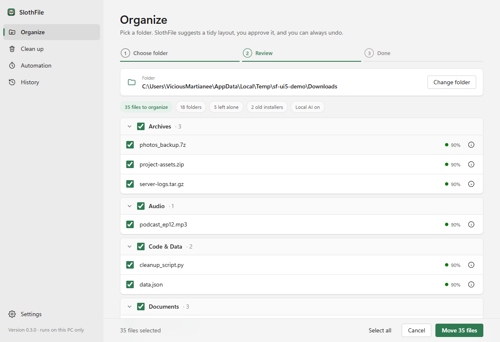
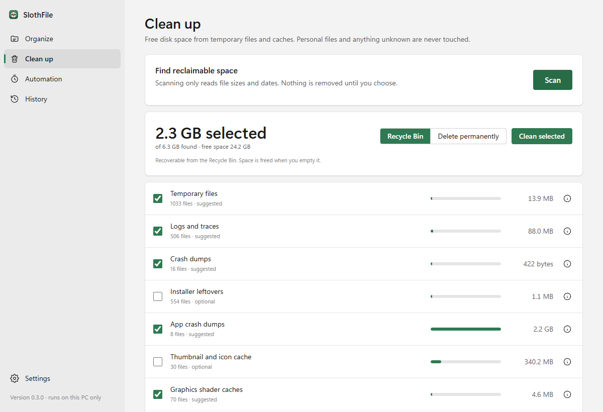
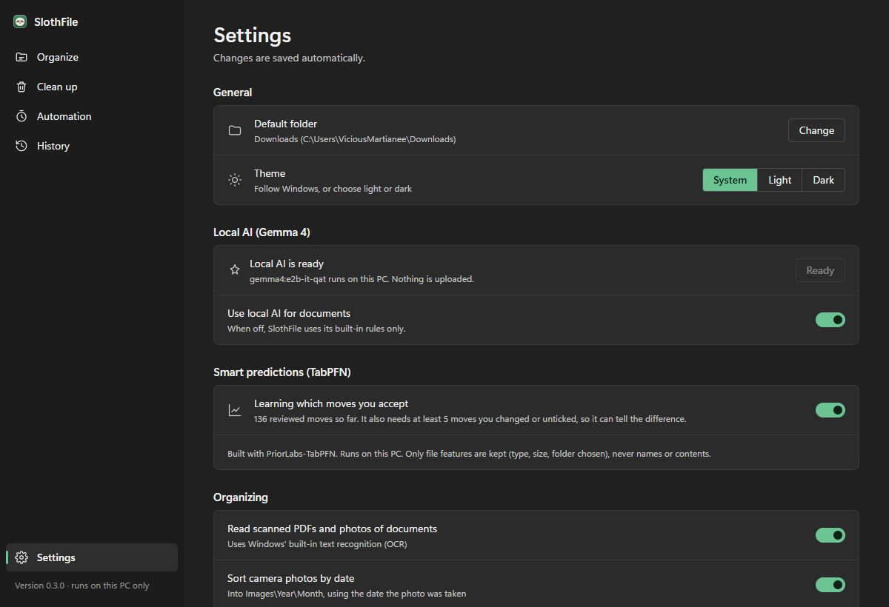

# SlothFile

**A Windows app that tidies your messy Downloads folder and frees up disk space — safely, on your own PC.**

Created by **[Bishesh Marasini](https://github.com/marasinibishesh)**.



- **Organize** — sorts files into folders (Documents, Images, Installers…), gives files like `document (3).pdf` a real name, and shows you the whole plan first. Nothing moves until you approve, and every run can be undone.
- **Clean up** — finds temporary files and caches you can safely remove (the safe version of Windows+R → `%temp%`). Files go to the Recycle Bin by default.
- **Automation** — tidy on a schedule, from the right-click menu, or with Windows+R → `slothfile`.
- **Private** — everything runs on your computer. No account, no upload.

---

## 1. Install

1. Go to the **[latest release](https://github.com/marasinibishesh/SlothFile/releases/latest)**.
2. Download one installer:

   | File | Size | Choose it if… |
   |---|---|---|
   | `SlothFile-Setup-<version>.exe` | ~16 MB | you want the normal app (**recommended**) |
   | `SlothFile-Setup-Full-<version>.exe` | ~250 MB | you also want *Smart predictions* (TabPFN) to work offline |

3. Run it. If Windows says **"Windows protected your PC"**, click **More info → Run anyway** (the installer is not code-signed).
4. Open **SlothFile** from the Start menu.

Needs Windows 10 or 11 (64-bit). No administrator rights are needed.

## 2. Use it

**Organize a folder**

1. Open **Organize**, pick a folder (or click *Downloads*), and click **Scan folder**. Scanning never changes anything.
2. Review the plan. Untick anything you don't want moved; click ⓘ to see why a file goes where it goes.
3. Click **Move files**. Changed your mind? Click **Undo** — now, or later from **History**.

**Free up space**

1. Open **Clean up** and click **Scan**.
2. Tick what to remove and click **Clean selected**. Files go to the Recycle Bin unless you choose *Delete permanently* (which asks you to confirm).

**Let it work for you**

Open **Automation** to tidy a folder every day, turn on the right-click menu entry, or add the Windows+R shortcut. Automatic runs only move the kinds of file you trust (installers, images, archives…). Documents always wait for you.



## 3. Settings

Open **Settings** (bottom-left) to change the default folder, the theme (System / Light / Dark), and which features are on.

- **Local AI (Gemma 4)** — optional. Reads documents to sort and name them better. Click **Set up** once: it installs [Ollama](https://ollama.com) and downloads Gemma 4 (about 4.3 GB). It runs entirely on your PC and can only *suggest*; you still approve every move.
- **Smart predictions (TabPFN)** — in the Full edition. After you have reviewed about 30 moves, it learns which moves you usually accept, so automatic runs only move files you would approve. It stores file features (type, size, folder), never names or contents.
- **Privacy & learning** — see or forget what SlothFile learned from your corrections.



## 4. Uninstall

**Settings → Apps → Installed apps → SlothFile → Uninstall.** This removes the app, its shortcuts and its scheduled tasks. Files you organized stay where they are.

Your undo history and settings are kept in `%LOCALAPPDATA%\SlothFile`; delete that folder too if you want them gone.

## Safety

- Scanning and previewing never change files. Only files directly inside the chosen folder are touched; subfolders are left alone.
- Nothing is ever overwritten. Name clashes get ` (2)`.
- Organizing never deletes. Duplicates are moved to a `Duplicates` folder.
- Every move is written to a journal first, so a run can be undone even after a crash or power cut.
- The AI can only pick from a fixed list of folders. It cannot move, delete or approve anything.
- Permanent delete and emptying the Recycle Bin are always separate, confirmed steps.

---

## For developers

### Run from source

Requires [Python 3.10+](https://www.python.org/downloads/) and Git. In PowerShell:

```powershell
git clone https://github.com/marasinibishesh/SlothFile.git
cd SlothFile
python -m venv .venv
.\.venv\Scripts\python -m pip install -e ".[content,desktop]"

.\.venv\Scripts\slothfile demo      # makes a messy sample folder to try it on
.\.venv\Scripts\slothfile desktop   # opens the app window
```

Optional Smart predictions in a source install:

```powershell
.\.venv\Scripts\python -m pip install torch --index-url https://download.pytorch.org/whl/cpu
.\.venv\Scripts\python -m pip install -e ".[predict]"
```

Everything is also available on the command line — run `.\.venv\Scripts\slothfile --help`. The installed app includes the same commands as `SlothFileCLI.exe`.

### Run the tests

```powershell
.\.venv\Scripts\python -m pip install -e ".[content,dev]"
.\.venv\Scripts\python -m pytest -q
```

Tests only use temporary folders.

### Build the installer

```powershell
python -m venv .venv-build
.\.venv-build\Scripts\python -m pip install "pywebview>=6.2" "pyinstaller>=6.22" "pypdf>=6.21.2" "pillow>=12"
.\.venv-build\Scripts\pyinstaller packaging\slothfile.spec --noconfirm --distpath packaging\output\dist --workpath packaging\output\build
winget install -e --id JRSoftware.InnoSetup --scope user
& "$env:LOCALAPPDATA\Programs\Inno Setup 6\ISCC.exe" packaging\slothfile.iss
```

The installer appears in `packaging\output\`. GitHub Actions builds both installers automatically and attaches them to a release whenever a version tag such as `v0.3.0` is pushed (see [`.github/workflows/build.yml`](.github/workflows/build.yml)).

---

## License and credits

**SlothFile is created by Bishesh Marasini** and released under the [MIT License](LICENSE).

It builds on:
- [Gemma 4](https://ai.google.dev/gemma) by Google, run locally with [Ollama](https://ollama.com) — optional, downloaded on your PC, not included here.
- [TabPFN](https://github.com/PriorLabs/TabPFN) by Prior Labs — **Built with PriorLabs-TabPFN.** The package is Apache 2.0; the v2 weights shipped in the Full edition are under the [Prior Labs License](https://huggingface.co/Prior-Labs/TabPFN-v2-clf/blob/main/LICENSE.txt).
- [pywebview](https://pywebview.flowrl.com), [pypdf](https://github.com/py-pdf/pypdf), [Pillow](https://python-pillow.org), [PyInstaller](https://pyinstaller.org) and [Inno Setup](https://jrsoftware.org/isinfo.php).

The full list of bundled components is in `THIRD-PARTY-NOTICES.txt` in the install folder.
