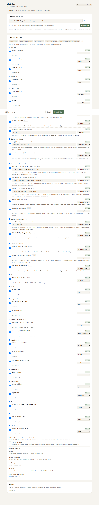
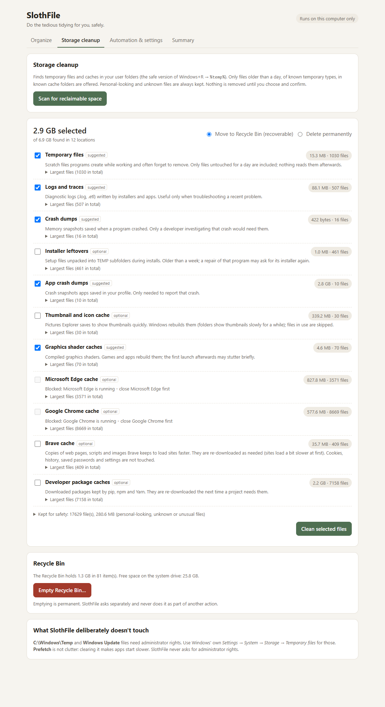
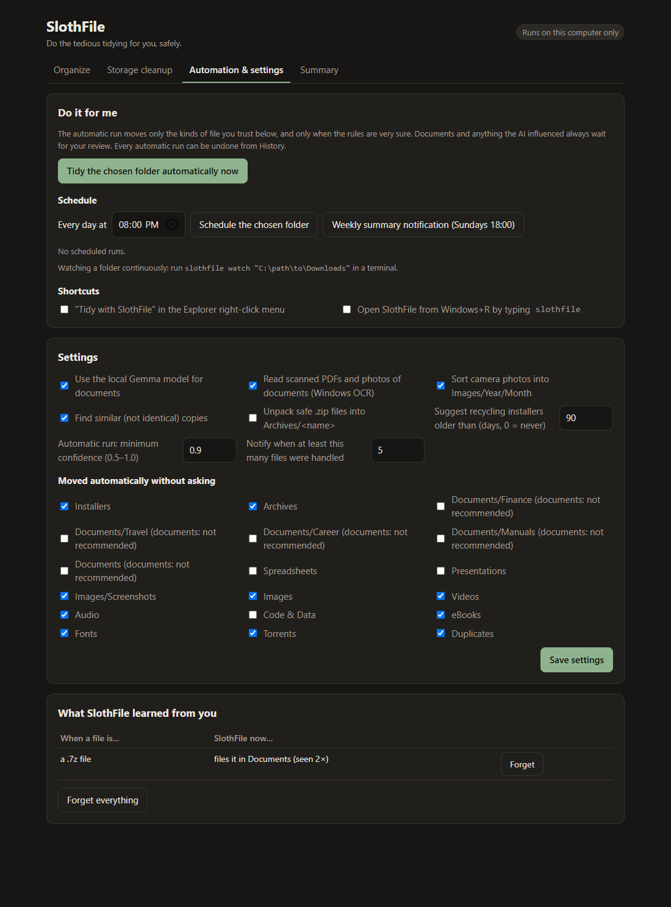

# SlothFile 🦥

**Tidy a messy Downloads folder and reclaim wasted disk space without doing the tedious part yourself, and without trusting an AI with your files.**

> **Created by [Bishesh Marasini](https://github.com/marasinibishesh).**

SlothFile looks at one folder you choose and reads what each file really is: its actual content, not just its extension. It proposes where every file should go and gives meaningless names like `document (3).pdf` a proper one. You see the whole plan, with the reason for every decision, **before anything happens**. Nothing moves until you approve. Every action is journaled and can be undone, even after a crash or power cut.

Everything runs **on your own computer**. Documents can optionally be read by **Gemma 4**, an open AI model that runs locally through Ollama. No file content is ever sent to the internet.



---

## Contents

1. [What it can do](#what-it-can-do)
2. [Requirements](#requirements)
3. [Quick start (5 minutes)](#quick-start-5-minutes)
4. [Optional: local AI with Gemma](#optional-local-ai-with-gemma)
5. [Using the app](#using-the-app)
6. [Command-line reference](#command-line-reference)
7. [Settings](#settings)
8. [Where SlothFile keeps its data, and how undo works](#where-slothfile-keeps-its-data-and-how-undo-works)
9. [Safety rules](#safety-rules)
10. [Uninstall](#uninstall)
11. [Troubleshooting](#troubleshooting)
12. [Running the tests](#running-the-tests)
13. [Project structure](#project-structure)
14. [Limitations](#limitations)
15. [License and credits](#license-and-credits)

---

## What it can do

### Organize a folder
- **Sorts files into folders:** `Installers`, `Archives`, `Documents/Finance`, `Documents/Travel`, `Documents/Career`, `Documents/Manuals`, `Documents`, `Spreadsheets`, `Presentations`, `Images`, `Images/Screenshots`, `Videos`, `Audio`, `Code & Data`, `eBooks`, `Fonts`, `Torrents` and `Duplicates`.
- **Renames meaningless files** from their content, for example `document (3).pdf` → `Receipt - Northwind Coffee Roasters - 2026-10-02.pdf`. A file that already has a meaningful name is never renamed.
- **Explains every decision**: keywords found, the real file type, the AI's reason, and the website the file was downloaded from.
- **Leaves risky files alone**:
  - programs disguised as photos (`holiday_photo.jpg` that is really an `.exe`);
  - "PDFs" that are saved web error pages;
  - unfinished downloads, hidden files, unknown types and empty files.
- **Duplicates** (byte-identical copies) are moved to `Duplicates`, never deleted. **Similar copies**, like a re-saved PDF or a resized photo, are suggested but start unticked.
- **Reads scanned PDFs and photos of receipts** with Windows' built-in OCR (nothing to download).
- **Photos by date:** camera photos go to `Images/2025/07` using the date the photo was taken.
- **Optional:** unpacks safe `.zip` files into `Archives/<name>/`.
- **Old installers** (older than 90 days, or for programs that are already installed) can go to the Recycle Bin. They start unticked and need a separate confirmation.
- **Undo any run**, even weeks later.

### Do it for you
- **Automatic tidy:** moves only the kinds of file you trust (installers, images, archives… by default). Documents always wait for your review. A Windows notification tells you what happened.
- **Daily schedule** and a **weekly summary** through Windows Task Scheduler, with no admin rights needed.
- **Watch a folder** and tidy new downloads as soon as they finish.
- **Learns from your corrections:** change a file's folder twice and SlothFile remembers it.
- **Shortcuts:** "Tidy with SlothFile" on the Explorer right-click menu, and **Windows+R → `slothfile`**.

### Storage cleanup (the safe version of Windows+R → `%temp%`)
- Finds reclaimable space in your temp folder, app crash dumps, Windows error reports, graphics shader caches, the thumbnail cache, Edge, Chrome and Brave caches, and pip, npm and Yarn caches.
- **Only** known temporary file types older than a day are offered. Personal-looking files, unknown files and files in use are **always kept**. Browser caches are skipped while the browser is open.
- Files go to the **Recycle Bin by default**. Permanent deletion and emptying the Recycle Bin each require typing a confirmation word.
- Reports exactly how much space was freed, and why any file was skipped.



---

## Requirements

| What | Version | Notes |
|---|---|---|
| **Windows** | 10 or 11 | SlothFile is built and tested on Windows 11. macOS and Linux are not supported yet |
| **Python** | 3.10 or newer | Tested with 3.12 and 3.14. Get it from [python.org](https://www.python.org/downloads/windows/), or run `winget install -e --id Python.Python.3.12` |
| **Git** | any | To clone the project ([git-scm.com](https://git-scm.com/download/win)), or download the ZIP from GitHub instead |
| **Ollama + Gemma 4** | optional | Only for AI reading of documents. SlothFile works fully without it |
| Disk space | ~60 MB, or ~5 GB with the AI model | |

No administrator rights are needed for anything.

---

## Quick start (5 minutes)

Open **PowerShell** (Start menu → type `PowerShell`) and run these commands one at a time.

### 1. Download the project

```powershell
git clone https://github.com/marasinibishesh/SlothFile.git
cd SlothFile
```

### 2. Create a private Python environment and install SlothFile

```powershell
python -m venv .venv
.\.venv\Scripts\python -m pip install --upgrade pip
.\.venv\Scripts\python -m pip install -e ".[content]"
```

`[content]` adds `pypdf` and `Pillow` so SlothFile can read PDF text and photo dates. To also run the tests, use `".[content,dev]"`.

> If `python` is not recognized, try `py -3` instead of `python` in the first command, or see [Troubleshooting](#troubleshooting).

### 3. Try it safely on a demo folder first

```powershell
.\.venv\Scripts\slothfile demo
```

This creates a disposable messy "Downloads" folder full of sample files and prints its location, for example `C:\Users\you\AppData\Local\Temp\slothfile-demo-xxxx\Downloads`.

### 4. Open the app

```powershell
.\.venv\Scripts\slothfile ui
```

Your browser opens SlothFile at `http://127.0.0.1:<port>`. Paste the demo folder's path (or click **Browse…**) and click **Preview plan**. Nothing changes until you click **Move files** and confirm. Afterwards, try **Undo this run**.

Keep the PowerShell window open while you use the app, and press **Ctrl+C** in it to stop SlothFile.

### 5. Use it on your real Downloads folder

```powershell
.\.venv\Scripts\slothfile ui "$env:USERPROFILE\Downloads"
```

> **Tip:** you don't need to "activate" the environment. Every command above calls the program inside `.venv` directly. If you prefer to activate it, run `.\.venv\Scripts\Activate.ps1` once per window, then just type `slothfile ...`.

### Alternative: one-click installer

From the project folder, this script sets everything up in `%LOCALAPPDATA%\SlothFile\app`. It can also download Ollama and the Gemma model, and add a Start Menu shortcut, the right-click menu entry and the Windows+R shortcut. It asks before every download or change.

```powershell
powershell -ExecutionPolicy Bypass -File .\scripts\install.ps1 -DryRun   # preview what it would do
powershell -ExecutionPolicy Bypass -File .\scripts\install.ps1           # install (asks questions)
powershell -ExecutionPolicy Bypass -File .\scripts\install.ps1 -NoModel  # install without the AI model
```

After installing, start SlothFile from the Start Menu ("SlothFile"), or with Windows+R → `slothfile` if you chose that option.

---

## Optional: local AI with Gemma

Without the AI, SlothFile uses its built-in rules. With it, sorting documents gets much better: in testing, accuracy rose from about 80% to about 97% on documents with unhelpful names, and meaningless file names get far better replacements. The model only ever sees short excerpts of **documents**, it runs **on your PC**, and it **cannot move or rename anything by itself**.

### 1. Install Ollama

```powershell
winget install -e --id Ollama.Ollama
```

Or download it from [ollama.com/download](https://ollama.com/download). Ollama starts automatically after installing; you'll see its icon in the system tray.

### 2. Download the model (about 4.3 GB, one time)

```powershell
ollama pull gemma4:e2b-it-qat
```

### 3. Use it

- **Web app:** tick **"Use local Gemma model for documents"** before clicking *Preview plan*.
- **Command line:** add `--model` to `slothfile plan`.

```powershell
.\.venv\Scripts\slothfile plan "$env:USERPROFILE\Downloads" --model
```

If Ollama isn't running or the model is missing, SlothFile says so and carries on with its rules. On a GTX 1660 Ti (6 GB) the model runs fully on the GPU and takes about 1.5 seconds per document. It also runs on the CPU, just more slowly.

---

## Using the app

Start it with `.\.venv\Scripts\slothfile ui` (optionally followed by a folder path). The app has four tabs.

### Organize tab
1. **Choose one folder.** Only files directly inside it are considered; subfolders are never touched.
2. **Preview plan.** SlothFile scans without changing anything and shows every file grouped by destination folder, with:
   - a confidence score and the reasons;
   - an editable new name (only for files with meaningless names);
   - a folder menu, to send a file somewhere else or choose "Leave it where it is";
   - badges: **Gemma** (the AI helped), **learned** (from your earlier corrections), **duplicate**, **similar copy**, **will unpack**.
3. **Review.** Untick anything you don't want moved. "Left untouched" lists files SlothFile won't touch, and why. "Old installers" (if any) start unticked.
4. **Move files.** Confirm, and SlothFile moves the files and shows the result.
5. **Undo this run**, now or later from **History**.

If an automatic run left files for you to review, a banner at the top offers **Review them**.

### Storage cleanup tab
1. Click **Scan for reclaimable space**. This only reads; nothing changes.
2. Each location shows its size, the number of files, and a plain explanation of why it's usually safe to remove and what it costs. Suggested locations are pre-ticked. Blocked ones (for example, a browser that is open) are greyed out.
3. Choose **Move to Recycle Bin** (recoverable, the default) or **Delete permanently** (you must type `DELETE`).
4. Click **Clean selected files**. The result shows the space freed, the free space before and after, and every skipped file with its reason.
5. **Empty Recycle Bin…** is a separate button. It requires typing `EMPTY`, and it empties the whole bin, not just SlothFile's files.

SlothFile never asks for admin rights and never touches `C:\Windows\Temp`, Windows Update files or Prefetch. Clearing Prefetch makes apps start slower; use Windows Settings → System → Storage for the admin-only areas.

### Automation & settings tab



- **Tidy the chosen folder automatically now:** moves only trusted kinds of file. Everything else waits for review on the Organize tab.
- **Schedule:** run every day at a time you choose, plus a weekly summary notification.
- **Shortcuts:** turn on the Explorer right-click entry and the Windows+R `slothfile` shortcut.
- **Settings:** switch individual features on or off, and choose which kinds of file may be moved without asking (see [Settings](#settings)).
- **What SlothFile learned from you:** every learned rule, with **Forget** buttons.

### Summary tab
What SlothFile did this week: files organized and renamed, space cleaned, runs undone, and where files went.

---

## Command-line reference

Everything in the app is also available from PowerShell. Replace `slothfile` with `.\.venv\Scripts\slothfile` unless the environment is activated.

### Organize

```powershell
slothfile demo                                   # create a disposable messy folder to practise on
slothfile plan "C:\Users\you\Downloads"          # read-only scan + preview (prints a plan id)
slothfile plan "C:\Users\you\Downloads" --model  # same, using the local Gemma model
slothfile apply <plan-id>                        # execute the plan (asks you to type YES)
slothfile apply <plan-id> --skip "file.pdf"      # leave a file out (repeatable)
slothfile apply <plan-id> --recycle              # also send suggested old installers to the Recycle Bin (asks again)
slothfile runs                                   # list past runs
slothfile undo <run-id>                          # undo a run
slothfile undo --last                            # undo the most recent run
slothfile recover "C:\Users\you\Downloads"       # after a crash or power cut: reconcile the journal with the disk
slothfile ui ["folder"] [--port 8080] [--no-browser]
```

### Automation

```powershell
slothfile auto "C:\Users\you\Downloads"              # move trusted kinds of file now, notify about the rest
slothfile auto "C:\Users\you\Downloads" --plan-only  # just prepare a plan for review
slothfile watch "C:\Users\you\Downloads"             # tidy new downloads as they finish (Ctrl+C to stop)
slothfile schedule add "C:\Users\you\Downloads" --at 20:00   # every day at 8 pm
slothfile schedule summary --day SUN --at 18:00      # weekly summary notification
slothfile schedule list
slothfile schedule remove "SlothFile\Tidy 1a2b3c4d"  # a name from 'schedule list'
slothfile summary [--days 7] [--notify]
slothfile learned                                    # show learned rules
slothfile learned --forget "host:example.com"        # forget one rule
slothfile learned --reset                            # forget everything
slothfile shell-install --run-alias                  # right-click menu + Windows+R shortcut
slothfile shell-uninstall                            # remove both
```

### Storage cleanup

```powershell
slothfile cleanup scan                                          # read-only; prints a report id and categories
slothfile cleanup clean <report-id> --categories temp_files,temp_logs,crashdumps   # to the Recycle Bin (asks YES)
slothfile cleanup clean <report-id> --categories temp_files --delete               # permanent (asks DELETE)
slothfile cleanup empty-bin                                     # empty the Recycle Bin (asks EMPTY)
```

`python -m slothfile <command>` works too.

---

## Settings

Change settings in the *Automation & settings* tab, or from the command line:

```powershell
slothfile settings                                   # show all settings
slothfile settings ocr=false photos_by_date=true     # change some
slothfile settings recycle_old_installers_days=0     # never suggest recycling installers
```

| Setting | Default | Meaning |
|---|---|---|
| `use_model` | `true` | Use Gemma for documents when Ollama is available |
| `ocr` | `true` | Read scanned PDFs and photos of documents with Windows OCR |
| `photos_by_date` | `true` | Put camera photos in `Images/<year>/<month>` |
| `near_duplicates` | `true` | Find similar (not identical) copies; they start unticked |
| `unpack_zip_archives` | `false` | Unpack safe `.zip` files into `Archives/<name>/` |
| `recycle_old_installers_days` | `90` | Suggest recycling installers older than this many days (`0` = never) |
| `auto_approve_categories` | installers, archives, screenshots, images, videos, audio, fonts, torrents, ebooks, duplicates | Kinds of file the automatic run may move without asking |
| `auto_min_confidence` | `0.9` | How sure the rules must be for the automatic run to move a file |
| `notify_min_files` | `5` | Only show a notification when at least this many files were handled |

---

## Where SlothFile keeps its data, and how undo works

Everything lives in **`%LOCALAPPDATA%\SlothFile`** (for example `C:\Users\you\AppData\Local\SlothFile`). Set the `SLOTHFILE_HOME` environment variable to use another folder.

| Folder or file | Contents |
|---|---|
| `runs\*.jsonl` | The journal of every run. Each move is written down **before** it happens. Plain text, so you can open it in Notepad |
| `plans\*.json` | Saved plans (what was proposed) |
| `cleanup\` | Storage cleanup scans and journals |
| `settings.json`, `learned.json` | Your settings and learned rules |

**Undo** puts every file from a run back where it was. It checks that each file is still the same file (size, date and a content hash), never overwrites anything, and removes the folders the run created if they are empty. If a file is open in another program, undo skips it and you can run undo again later.

**After a crash or power cut,** SlothFile refuses to start a new run on that folder until you click **Recover now** in the app or run `slothfile recover <folder>`. Recovery compares the journal with what is actually on disk, so nothing is lost or moved twice.

---

## Safety rules

1. Scanning and previewing never change your files.
2. Only files directly inside the chosen folder are candidates. Subfolders are never entered, and links and junctions are never followed.
3. **Nothing is ever overwritten.** Moves use an operation that fails if the destination exists, and clashing names get " (2)".
4. Organizing never deletes anything. Duplicates are moved aside. Only Storage Cleanup removes files, by default to the Recycle Bin, and only after you confirm.
5. A file that changed after the preview is skipped.
6. The saved plan is re-checked when it runs, so a tampered plan can't send files outside the folder or outside SlothFile's own category folders.
7. The AI can only choose from a fixed list of folders and suggest a name built from words in the document. It can't name paths, approve anything or touch files.
8. Irreversible actions (permanent delete, emptying the Recycle Bin) are never bundled with anything else, and each needs a typed confirmation.
9. Automation moves only the kinds of file you trust, decided by the rules alone, and every automatic run can be undone.
10. The web app only listens on your own computer (`127.0.0.1`) and requires a secret per-session link.

---

## Uninstall

1. Remove the extras SlothFile may have added (right-click menu, Windows+R shortcut, scheduled tasks):

   ```powershell
   .\.venv\Scripts\slothfile shell-uninstall
   .\.venv\Scripts\slothfile schedule list      # then, for each task:
   .\.venv\Scripts\slothfile schedule remove "<task name>"
   ```

2. Delete the project folder (`SlothFile`, including `.venv`).
3. Optionally delete `%LOCALAPPDATA%\SlothFile`. This removes your undo history, so undo is no longer possible.

If you used the one-click installer, run `powershell -ExecutionPolicy Bypass -File .\scripts\uninstall.ps1` instead. It asks before removing anything and never touches your organized files.

Your organized files stay where they are. Undo any runs you want reversed **before** uninstalling.

---

## Troubleshooting

| Problem | Fix |
|---|---|
| `python` is not recognized | Install Python from python.org and tick **"Add python.exe to PATH"**, or use `py -3 -m venv .venv`. If a Microsoft Store window opens instead, turn off *App execution aliases* for Python in Windows Settings |
| `Activate.ps1 cannot be loaded because running scripts is disabled` | You don't need to activate: use `.\.venv\Scripts\slothfile ...` as shown. Or allow it for your user only: `Set-ExecutionPolicy -Scope CurrentUser RemoteSigned` |
| `pip install` fails | Check your internet connection, then run `.\.venv\Scripts\python -m pip install --upgrade pip` and try again |
| The browser doesn't open | Copy the `http://127.0.0.1:...?t=...` link printed in PowerShell into your browser. The `?t=...` part is required |
| "Local model unavailable" | Start Ollama (Start menu → Ollama) and check that `ollama list` shows `gemma4:e2b-it-qat`. SlothFile still works without it |
| "A previous run on this folder was interrupted" | Click **Recover now** in the app, or run `slothfile recover "<folder>"` |
| A file was "skipped: file is open in another program" | Close that program and run the plan or undo again |
| Browser cache shows "Blocked" in Storage cleanup | Close that browser completely, then scan again |
| OCR does nothing | OCR uses Windows' own OCR languages. Check Windows Settings → Time & language → Language. SlothFile works without OCR |
| A port is already in use | Start with another port: `slothfile ui --port 8765` |

---

## Running the tests

```powershell
.\.venv\Scripts\python -m pip install -e ".[content,dev]"
.\.venv\Scripts\python -m pytest -q
```

The tests create and clean up temporary folders only; they never touch your own files. Expect something like `355 passed, 1 skipped`. The skipped test needs Windows Developer Mode to create symbolic links. They cover:
- crashes before, during and after a move, mid-unpack and mid-recycle;
- junction and path-escape attacks, tampered plans and alias file names;
- locked files, prompt injection and broken AI responses;
- the web app's access checks.

---

## Project structure

```
SlothFile/
├── slothfile/              the application
│   ├── cli.py              command-line interface
│   ├── web.py, ui.html     local web app (127.0.0.1 only)
│   ├── scanner.py          read-only folder scan, file-type sniffing, provenance
│   ├── extract.py          bounded text and metadata extraction (in a separate process)
│   ├── rules.py            built-in classifier and namer
│   ├── llm.py, engine.py   optional Gemma (Ollama) adviser and how its advice is used
│   ├── planner.py          builds the reviewable plan
│   ├── executor.py         journaled, verified, undoable execution and crash recovery
│   ├── cleanup.py          Storage Cleanup
│   ├── winshell.py         Recycle Bin and other Windows shell helpers
│   ├── automation.py       auto-run, watch, schedules, notifications, shortcuts
│   ├── learning.py         learning from your corrections
│   ├── ocr.py, ocr.ps1     Windows built-in OCR
│   ├── archives.py         safe zip unpacking
│   ├── neardup.py          similar-copy detection
│   ├── photos.py           photos by date
│   ├── summary.py          weekly summary
│   └── ...                 helpers (paths, journal, settings, models)
├── tests/                  automated tests (pytest)
├── scripts/
│   ├── install.ps1         one-click installer (asks before every step; -DryRun to preview)
│   └── uninstall.ps1
├── docs/screenshots/
├── pyproject.toml
└── LICENSE
```

---

## Limitations

- **Windows only for now.** It is tested on Windows 11 with NTFS; macOS and Linux are untested.
- Undo restores locations and names. Files you edited after organizing are skipped, never overwritten.
- OCR depends on the languages installed in Windows. It reads at most 2 pages of a scanned PDF and up to 200 images per scan.
- Similar-copy detection is a heuristic, which is why those rows start unticked. Exact duplicates are detected precisely (SHA-256).
- Storage Cleanup only covers user-level locations, and it doesn't remove the empty folders it leaves behind.
- Restoring a recycled installer on undo goes through the Recycle Bin's shell interface. If that fails, SlothFile says so and you restore the file from the Recycle Bin yourself.
- File parsing runs in a separate process with a time limit. That is not a full security sandbox.

---

## License and credits

**SlothFile was created by Bishesh Marasini** and is released under the [MIT License](LICENSE).

Open-source pieces it builds on:
- [pypdf](https://github.com/py-pdf/pypdf) (BSD-3-Clause) and [Pillow](https://python-pillow.org) (MIT-CMU): optional, for PDF text and image metadata.
- [Gemma 4](https://ai.google.dev/gemma) by Google (Apache 2.0): optional local AI model. It is **not included** in this repository; Ollama downloads it on your machine.
- [Ollama](https://ollama.com) (MIT): optional, runs the model locally.
- Windows' built-in OCR, Task Scheduler and Recycle Bin are used through their standard interfaces.
